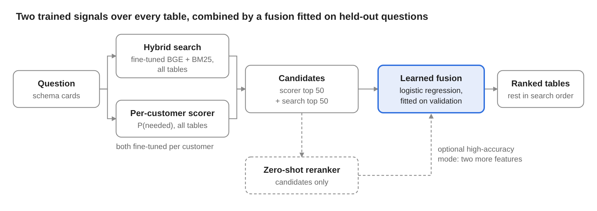

# NIFT-SQL

NIFT-SQL = Necessity-Informed Fusion for Text-to-SQL.

Table retrieval for enterprise text-to-SQL from table names, column names and declared keys only: hybrid search, a small scorer fine-tuned per customer that scores every
table (headline: a fine-tuned bge-reranker-large cross-encoder; pre-specified: the Laya decision model, 421M), and a
logistic-regression fusion fitted on held-out questions. No generative LLM calls.

Code and aggregated results for the paper:

> Arjun Rao and Nishant Gopinath. **NIFT-SQL: Customer-Supervised Table Scoring for Enterprise Text-to-SQL Retrieval.**
> arXiv:2611.12731, 2026. https://arxiv.org/abs/2611.12731

**Every number in the paper:** [`results/paper/PAPER_TABLES.txt`](results/paper/PAPER_TABLES.txt) and the other files in
`results/paper/`. Table numbers in this repository follow the arXiv version; a later journal version may renumber them.

This repository contains no benchmark data and no model weights. The code downloads public models and retrains the
per-customer models. Never commit data, model weights, API keys or tokens: `tests/test_pipeline.py` fails if it finds any.



## Main result

**Final method (paper Table 2):** NIFT-SQL = fine-tuned cross-encoder + hybrid search over a BGE retriever fine-tuned per
customer + logistic-regression fusion fitted on validation. Test complete@15, mean over seeds 1 to 4 and three training runs:
**69.2 / 89.5 / 85.6** (BEAVER / LiveSQLBench / LiveSQLBench-Large); high-accuracy mode (+ two Qwen3-Reranker-8B features)
72.4 / 92.5 / 88.6. Source: `results/paper/FUSION_EXTENSIONS.txt` (`experiments/fusion_extensions.py`).
The fine-tuned retriever was adopted after its test results; the pre-specified configuration is NIFT-SQL-base below.

**NIFT-SQL-base** (off-the-shelf search, main training run), the configuration used for the component analyses:

Test, mean over 4 random splits (seeds 1 to 4), complete@15 = share of questions with **every** required table in the top 15.

| complete@15 (%) | BEAVER (463 tables) | LiveSQLBench (244) | LiveSQLBench-Large (971) |
|---|---|---|---|
| Hybrid search (BGE-large + BM25) | 30.4 | 41.0 | 21.8 |
| Search + Qwen3-Reranker-8B (zero-shot) | 53.6 | 77.1 | 50.3 |
| Laya alone | 31.0 | 51.6 | 54.7 |
| Fine-tuned cross-encoder alone | 45.2 | 69.1 | 71.7 |
| Rank average, Laya + search (no learning) | 60.1 | 68.6 | 62.3 |
| NIFT-SQL-base with Laya (pre-specified) | 60.1 | 83.2 | 79.1 |
| **NIFT-SQL-base with fine-tuned cross-encoder** | **67.3** | **86.2** | **78.6** |

**The scorer is interchangeable.** The configuration with Laya was frozen before the test runs. The cross-encoder
(bge-reranker-large fine-tuned on exactly Laya's rows, same fusion) was added afterwards with fixed settings and run once
on the same splits. It matches or beats Laya (complete@15 difference +7.1 [0.0, 14.5], +2.9 [-2.6, 8.6], -0.7 [-5.9, 4.5];
ahead in 5 of 6 complete@8/15 comparisons, never significantly behind) at about half the training and scoring time, so it
is the headline. Details: `results/paper/SUPERVISED_CROSSENCODER_bge-reranker-large.txt` and `..._timing.txt`.

**Training is what matters.** The same cross-encoder used zero-shot in the same pipeline is 20.9 [16.2, 25.6] points lower in
complete@15 (pooled over the three datasets). Removing join hints costs 6.2 and 4.8 points on the LiveSQLBench sets and nothing
on BEAVER (which has no declared keys). With the cross-encoder, 21 to 69 training questions per customer already lift
complete@15 by 26 to 55 points over search. All in `results/paper/CE_ANALYSIS.txt` (`experiments/ce_analysis.py`).

Confidence intervals, complete@8, recall, the breakdown by number of tables, shortlist coverage, the training-size curve
and cost are in `PAPER_TABLES.txt` (Laya), `CE_ANALYSIS.txt` (cross-encoder) and the paper.

## Code version

Commit hashes below refer to the authors' development repository, whose history is not published; this public
repository starts from the released code.

| What | Commit | Config |
|---|---|---|
| Main runs, seeds 1 to 4 (`nift_base`) | `8c75bed` | `configs/default.yaml` (hash `0b1ff5b42ddf`) |
| Training-size runs (`nift_train10/20/30`) | `43e7e2c` | `configs/train10/20/30.yaml` |
| Appendix A runs, seeds 1 and 2 (`arjun_v3j`) | `faa94ab` | `configs/nift_ftj.yaml` |
| Cross-encoder runs, seeds 1 to 4 (`nift_ce`) | `aecb1ca` | `experiments/supervised_crossencoder.py`, same splits |
| Paper tables | `66e3891` | |

`main.py`, `nift/` and `configs/` are byte-identical from `8c75bed` to commit `4e0b545` (the paper release), so the code here is the code
that produced the main results. Later commits only added analysis scripts and results files.

## Reproduce

Data: the table-retrieval releases of BEAVER, LiveSQLBench and LiveSQLBench-Large in one folder
(`beaver/`, `livesqlbench_table/`, `livesqlbench_large_table/`, each with `corpus.jsonl`, `queries.jsonl`, `qrels/test.tsv`).

```
pip install -r requirements.txt
python reproduce_paper.py --data <DATA_ROOT> --out <OUT_ROOT>      # everything, resumable, logs in <OUT_ROOT>/results/logs
python main.py --seed 1 --name nift_base --data <DATA_ROOT> --out <OUT_ROOT>   # one run
```

About 20 minutes per run on one A100-class GPU (Laya scoring dominates), 18 runs in total, plus about 30 minutes for the
reranker. In Colab: clone the repository, `pip install -r requirements.txt`, then run the same command in a cell.
The appendix studies B to D are separate scripts: see [`experiments/README.md`](experiments/README.md).

## How one run works (`main.py`, top to bottom)

1. **Load** schema cards (`TABLE: col, col, ...`; names-and-keys setting: no types, comments or values) and declared joins (`nift/data.py`).
2. **Split** 50 / 30 / 20 train / validation / test, grouped so a gold-table set or a question text never spans two parts
   (`nift/split.py`, hard checks).
3. **Search** every table: 0.6 x BGE-large-en-v1.5 + 0.4 x BM25, min-max normalised (`nift/search.py`).
4. **Training rows** from train only: every gold table (yes), 4 top non-gold by search (no), 1 random non-gold (no)
   (`nift/scorer.py`).
5. **Train Laya** per customer from `convaiinnovations/laya` (laya 0.4.8), 4 epochs.
6. **Score** every table for validation and test questions.
7. **Fit the fusion** on validation: logistic regression on 8 features over Laya top 50 + search top 50 (`nift/fusion.py`).
8. **Test once**: writes `results.csv` and `summary.txt`; refuses to score a seed's test set twice (`nift/evaluate.py`).

Customers: BEAVER; LiveSQLBench + LiveSQLBench-Large together (they share databases and questions). Seed 0 is development only.

## Repository map

```
main.py                 one run, the 8 steps above
reproduce_paper.py      every run and table of the paper, in order
nift/                   the method (data, split, search, scorer, fusion, evaluate, costs, pipeline, budget)
configs/                default.yaml (the paper), train10/20/30.yaml (training size), nift_ft/nift_ftj.yaml (appendix A)
experiments/            baselines, analyses and appendix studies (see experiments/README.md)
results/paper/          the paper's numbers (aggregated; no per-question data)
results/exploratory/    outputs of the appendix B to D studies (validation only)
v2/                     loader for the newer BEAVER release used in the frozen-method holdout (experiments/confirm_beaver_v3.py)
docs/                   the method figure
tests/                  fake data and a fake Laya: the whole pipeline runs on CPU (pytest -q tests)
```

## Tests

```
pip install -r requirements.txt
python -m pytest -q tests
```

They check split rules, metrics, the end-to-end pipeline on fake data, caching, the scoring budget, that finished runs
keep their manifest, and that no secrets or data are in the repository. The fake Laya's numbers mean nothing.

## Changing the method

`configs/default.yaml` is frozen. A change gets its own config and run name, is tried on seed 0 validation only, and is
adopted only if it gains at least +2.0 mean complete@8 on validation with no dataset significantly worse. The code
refuses to reuse a run folder made with a different config or different table cards.

## Citation

```
@article{rao2026niftsql,
  title   = {NIFT-SQL: Customer-Supervised Table Scoring for Enterprise Text-to-SQL Retrieval},
  author  = {Rao, Arjun and Gopinath, Nishant},
  journal = {arXiv preprint arXiv:2611.12731},
  year    = {2026}
}
```

## Related work by the same authors

FERN (arXiv:2611.14477) studies the opposite case: a ranker trained once on public data, with no supervision from the
target catalog.

## Licence

No licence file has been added yet. Until one is, the default copyright rules apply: you may read the code, but reuse
needs the authors' permission.
